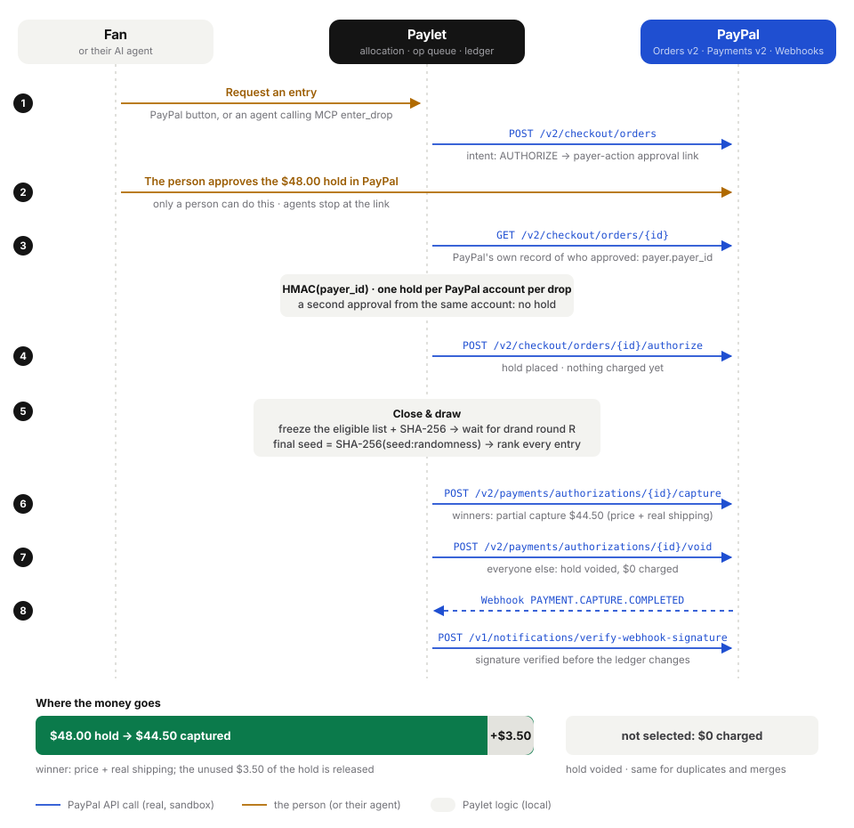
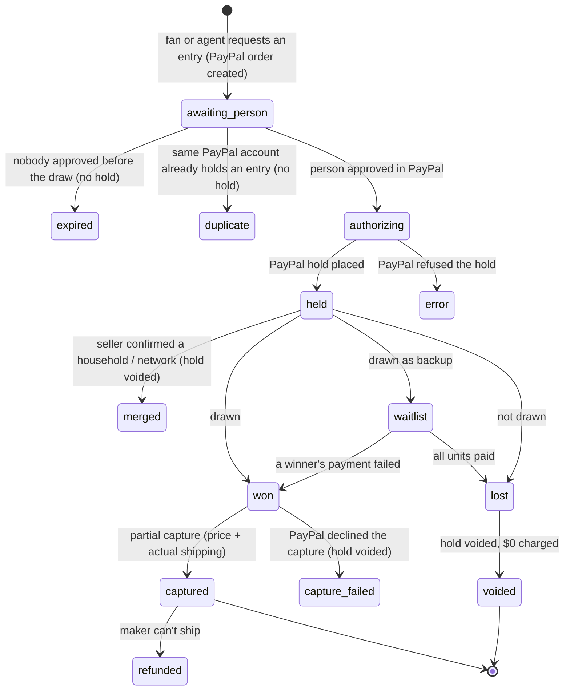
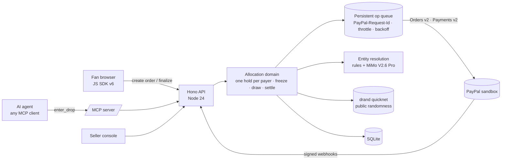

# Paylet: fair drops for the agent era

**Agents can enter. Only people can pay.** Every entry is a PayPal hold, one per PayPal account, and losers are never charged.

[](https://github.com/KaraAliOsman/paylet/actions/workflows/ci.yml)
[](https://github.com/KaraAliOsman/paylet/actions/workflows/e2e-prod.yml)
[](docs/e2e-real/README.md)
[](tests)
[](vitest.config.ts)
[](https://github.com/KaraAliOsman/paylet/actions/workflows/codeql.yml)
[](LICENSE)


Paylet runs fair limited drops for small makers. A fan, or the fan's AI agent over **MCP**, requests an entry; the entry
only counts once the person approves a **PayPal hold** (Orders v2 `intent: AUTHORIZE`). Paylet allows **one hold per PayPal
account**, uses **AI** to point out households and reseller networks hiding behind several accounts (the seller decides),
and draws winners with **public randomness** anyone can re-check. Winners are **partially captured** (price + actual
shipping); everyone else's hold is **voided**. If a winner's payment fails, the next fan on the waitlist, whose hold
already exists, gets the unit.

> **Live demo:** https://paylet.onrender.com · **Judges:** [`/judge`](https://paylet.onrender.com/judge), a guided 2-minute run ("try to scalp us")
> **Finished real run, no login needed:** https://paylet.onrender.com/d/ember-glaze-mug-2710 · **Video:** see the Devpost submission
> PayPal **sandbox only**: no real money moves. The demo runs on a free instance: the first request after it sleeps takes about a minute.


| Fan's agent stops at PayPal | Re-run the draw in your browser | Evals |
|---|---|---|
|  |  |  |

**Contents:** [Inspiration](#inspiration) · [Why PayPal](#why-paypal-and-what-paypal-could-ship-paypal-verified-drops) ·
[How it works](#how-it-works) · [Proven against the real sandbox](#proven-against-the-real-paypal-sandbox) ·
[Unhappy paths](#unhappy-paths) · [Impact](#impact) · [Is this a raffle?](#is-this-a-raffle) ·
[Judging criteria](#judging-criteria--where-to-see-it) · [Bring your own agent](#bring-your-own-agent) ·
[AI](#how-ai-is-used) · [Data flow & PII](#data-flow--pii) · [Launch requirements](#launch-requirements) ·
[Quickstart](#quickstart)

## Inspiration
I went looking at how small makers sell ten of something to hundreds of fans. On January 17, 2026, the keycap maker
Dragon-key announced a [drop on KeebTalk](https://www.keebtalk.com/t/artisan-raffle-dragon-key-colorway-pink-marshmallow/23724):
**10 keycaps per character at $65**, a form open for **24 hours**, invoices sent **30 to 90 minutes** after it closes, and
**24 hours** to pay. Jelly Key's [rules](https://www.jellykey.com/raffle) say it plainly: *"Only one entry is allowed… We
only accept PayPal for raffle sales… Unpaid invoices will result in keycaps being raffled again."*

So the ritual is: a form that asks for one entry per person, PayPal invoices sent by hand, and winners who never pay, so
the maker draws again. A knife collector [summed it up](https://www.bladeforums.com/threads/makers-using-the-drop-marketing-strategy.2070195/)
in April 2026: *"Lotteries require admin work and have the risk of nonpayment from nonserious entrants."* And one keyboard
fan had already [described the fix](https://www.keebtalk.com/t/not-the-best-keyboard-dilemma-good-or-bad/17798/33) in 2022:
*"The only thing I can think of would be a raffle where you had to put in a credit card to hold your entry."*

That is Paylet, with a **PayPal hold** instead of a card number: the maker never touches card data, the loser is never
charged, and the winner can't ghost because the money is already held. Meanwhile scalpers open more accounts (the FTC
alleges one broker used [1,300 accounts to buy 7,624 tickets for a single concert](https://www.ftc.gov/news-events/news/press-releases/2026/10/ftc-sues-ticket-broker-over-unlawful-tactics-used-buy-millions-tickets-popular-live-events)),
and now AI agents can fill in a form a thousand times. Blocking agents would punish fans whose assistants shop for them,
so Paylet welcomes them, and lets **PayPal** decide who is a real customer.
<!-- If a maker answers the outreach (entrega/OUTREACH.md), put their quote here. -->

## Why PayPal, and what PayPal could ship: PayPal Verified Drops
On PayPal's Q3 2026 earnings call (October 27, 2026), CEO Enrique Lores described what agentic commerce needs:
*"If you think about consumer agents that will be buying from agents, from merchants, both will have to validate that this
is a real consumer that can pay, this is a real merchant that have the product, and that is the value that we see PayPal
playing going forward."* ([transcript](https://www.fool.com/earnings/call-transcripts/2026/10/27/paypal-pypl-q3-2026-earnings-call-transcript/))

A PayPal hold is exactly that validation, available today: **proof of a real customer who can pay**, without charging
anyone. Paylet builds a fair allocation on top of it:

- **The PayPal account is the allocation key.** After approval, Paylet reads the payer from PayPal's own order record
  (`GET /v2/checkout/orders/{id}`) and enforces one hold per payer *before* calling `/authorize`.
- **Agents are first-class but cannot pay.** An agent gets PayPal's approval link and stops; only the person can approve.
  PayPal becomes the human-in-the-loop for agentic commerce.
- **What PayPal gains:** every entrant, winner or not, goes through a PayPal checkout; a new use for `AUTHORIZE`, partial
  capture and void (money committed without being moved); and a claim no other checkout has: *the fairest way to sell
  something limited*.

**If PayPal shipped this natively (hypothetical API, not available today):**
```jsonc
POST /v2/checkout/orders
{ "intent": "AUTHORIZE",
  "purchase_units": [{ "amount": { "currency_code": "USD", "value": "48.00" },
    "allocation_policy": { "scope": "drop_123", "limit_per_payer": 1,
                           "agent_entries": "allowed_with_person_approval" } }] }
// → 422 PAYER_ALLOCATION_LIMIT_REACHED on a second approval by the same payer
```
Native support would enforce the limit inside PayPal, before the approval, across every merchant that runs drops.

## How it works


| Step | What happens | PayPal |
|---|---|---|
| 1. Request | A fan clicks the PayPal button (JS SDK v6), or their agent calls `enter_drop` over MCP and gets an approval link. **The agent stops there.** | `POST /v2/checkout/orders` (`AUTHORIZE`, `payer-action` link) |
| 2. One per account | After approval Paylet reads the payer **server-side**, keeps the payer id only as an HMAC, and enforces a unique constraint on it per drop before authorizing. A second approval from the same account places **no hold**. | `GET /v2/checkout/orders/{id}` → `POST …/authorize` |
| 3. Households & networks | Rules normalize addresses (suffixes, `Ste/Unit/#`, `c/o`, mailbox aliases). Only fuzzy pairs go to the model, which must cite fields and may keep pairs apart. **Nothing is auto-merged**: the seller confirms, and the draw is blocked while suggestions are pending. | — |
| 4. Freeze | At close, the eligible list is frozen and its SHA-256 published, together with every exclusion and its reason. The seed's SHA-256 was published when the drop opened. | — |
| 5. Public randomness | Paylet waits for a future [drand](https://drand.love) quicknet round that nobody could know at freeze time, then reveals the seed. `finalSeed = SHA-256(seed + ":" + round randomness)`; each entry ranks by `SHA-256(finalSeed + ":" + publicId)`. Not even Paylet knew the winners in advance. | — |
| 6. Settle | Winners: **partial capture** (price + *actual* shipping, the rest of the hold released). Everyone else: **void**. Failed capture → next on the waitlist, whose hold already exists. Signed webhooks move state; a sweeper re-checks with GETs. | `…/authorizations/{id}/capture`, `…/void`, webhooks + `verify-webhook-signature` |
| 7. After the sale | The maker marks the order shipped (tracking appears in the buyer's PayPal account) or refunds if they can't ship. | `POST /v2/checkout/orders/{id}/track`, `POST /v2/payments/captures/{id}/refund` |
| 8. Verify | `/verify/<drop>` recomputes every hash and the draw in your browser, and **Ask PayPal** re-checks each hold against PayPal's records. | `GET /v2/payments/authorizations/{id}` |

### Entry lifecycle


### How PayPal is used (and where in the code)
| PayPal capability | File |
|---|---|
| **TypeScript Server SDK** (`@paypal/paypal-server-sdk` 2.5.0, APIMatic-generated): orders, authorize, capture, void, get authorization, refund, tracking | [`src/server/paypal.ts`](src/server/paypal.ts) |
| `PayPal-Request-Id` on every money-moving call; persistent op queue with throttle and `Retry-After` backoff | [`src/server/queue.ts`](src/server/queue.ts) |
| **JS SDK v6** one-time payment session (`<paypal-button>`) | [`src/web/components.tsx`](src/web/components.tsx) |
| Webhooks: registration, signature verification, de-duplication, state changes | [`src/server/index.ts`](src/server/index.ts), [`src/server/domain.ts`](src/server/domain.ts) |
| Allocation: finalize (one per payer), freeze, draw, partial capture, void, waitlist promotion, sweeper | [`src/server/domain.ts`](src/server/domain.ts) |
| **MCP server** for agents (`list_drops`, `enter_drop`, `entry_status`; Streamable HTTP) | [`src/server/mcp.ts`](src/server/mcp.ts) |

**Tools used while building:** the **APIMatic Context Plugin** for the PayPal Server SDK in Claude Code
([review and changes](docs/apimatic-context-plugin.md)), and PayPal's official **AI-Toolkit** (`/paypal:doctor`,
`/paypal:explain-error`) to audit the integration ([findings → changes](docs/paypal-ai-toolkit.md)).

## Proven against the real PayPal sandbox
Mocked tests prove our logic; these prove PayPal agrees. [`e2e/real-paypal.spec.ts`](e2e/real-paypal.spec.ts) logs in as a
sandbox buyer **inside PayPal's own window**, and every hold, capture and void it produces is cross-checked with PayPal
(`GET /v2/payments/authorizations/{id}`), on top of Paylet's own records. Last recorded run: **5/5 passed on 2026-10-31
(commit `4e11af4`)** against https://paylet.onrender.com ([record](docs/e2e-real/latest.json)).

| # | Real scenario | What the test asserts | Checked with |
|---|---|---|---|
| 1 | JS SDK v6 button → hold; same PayPal account again → "no hold placed" | the authorization is `CREATED`; Paylet counts 1 hold and 1 blocked duplicate | PayPal + Paylet |
| 2 | Agent's approval link → person approves → draw → winner captured | the authorization is `PARTIALLY_CAPTURED` / `CAPTURED`; Paylet captured $44.50 of the $48.00 hold | PayPal + Paylet |
| 3 | Sandbox negative test on the only real entrant (no waitlist) | the capture fails; the authorization ends `VOIDED`, never charged | PayPal + Paylet |
| 4 | Real entrant + labelled simulated crowd + AI review → draw | whichever way the draw goes, PayPal agrees: `CAPTURED` if the real entrant won, `VOIDED` if not | PayPal + Paylet |
| 5 | Buyer cancels inside PayPal | the return page says no hold was placed; 0 holds | Paylet |

- [`scripts/paypal-approve.ts`](scripts/paypal-approve.ts) is a reusable recipe for driving the PayPal sandbox approval page
  with Playwright (login, "already logged in", guest-to-login switch, review page), in English or Spanish.
- No login needed to see real money: the **proof drop** (https://paylet.onrender.com/d/ember-glaze-mug-2710) is a finished run with real sandbox money:
  14 real PayPal orders · 13 agent requests → 0 holds without a person · 1 same-account duplicate blocked · partial capture $44.50 ($3.50 of the hold released) · tracking added in PayPal · $0.00 charged to anyone who lost. Its **Ask PayPal now** button re-checks every authorization with PayPal live.
- The daily [`e2e-prod`](.github/workflows/e2e-prod.yml) job runs the judge flow against production (real sandbox orders
  from the scalper agents, AI review, draw, browser verification) and keeps the Playwright report.

### Idempotency keys
Every money-moving call is an op in a persistent queue; the op key **is** the `PayPal-Request-Id`, so a retry after a crash,
a timeout or a 429 replays the same request and can never charge twice.

| Key | PayPal call |
|---|---|
| `create:<entryId>` | `POST /v2/checkout/orders` |
| `auth:<entryId>` | `POST /v2/checkout/orders/{id}/authorize` |
| `cap:<authorizationId>:1` | `POST /v2/payments/authorizations/{id}/capture` |
| `void:<authorizationId>` | `POST /v2/payments/authorizations/{id}/void` (after a GET: a void is not idempotent on PayPal's side) |
| `refund:<captureId>` | `POST /v2/payments/captures/{id}/refund` |
| `track:<captureId>` | `POST /v2/checkout/orders/{id}/track` |

## Unhappy paths
| Scenario | What Paylet does | Proven by |
|---|---|---|
| Same PayPal account enters again (another tab, `/agent`, or 40 agents) | Order approved, but no `/authorize`: "no hold placed", counted as a blocked duplicate | unit: the duplicate never reaches `/authorize` ([`flow.test.ts`](tests/flow.test.ts)) · real sandbox #1 |
| An agent requests an entry and nobody approves | No hold ever exists; the request expires at the draw and never enters the ballot | code: `draw()` in [`domain.ts`](src/server/domain.ts) · `e2e-prod`: 3 agents → 3 PayPal links, 0 holds |
| Buyer cancels in PayPal | No hold is placed, and the return page says so | real sandbox #5 |
| A winner's capture is declined | GET the authorization, void it if still alive, promote waitlist #1 (hold already in place) | unit: waitlist promotion after a failed capture ([`flow.test.ts`](tests/flow.test.ts)) · real sandbox #3: the authorization ends `VOIDED` · code: capture failure handler in [`domain.ts`](src/server/domain.ts) |
| Capture comes back `PENDING` | Entry waits; `PAYMENT.CAPTURE.COMPLETED` / `DENIED` webhooks, or the sweeper's GET, settle it | code: webhook routing + sweeper in [`domain.ts`](src/server/domain.ts) |
| PayPal answers 429, 5xx or times out | Retried with the same `PayPal-Request-Id`, honoring `Retry-After`; configuration errors never consume the waitlist | code: [`queue.ts`](src/server/queue.ts), `classify()` in [`paypal.ts`](src/server/paypal.ts) |
| Webhook replayed, or unsigned | De-duplicated by `event_id`; unverified signature → 401, nothing changes | unit: unsigned → 401 ([`flow.test.ts`](tests/flow.test.ts)) · de-duplication: code, the `webhook_events` insert in [`index.ts`](src/server/index.ts) |
| Approval arrives after the drop closed | No hold; if PayPal authorized in the race, the hold is voided at once | code: `finalize()` and the authorize handler in [`domain.ts`](src/server/domain.ts) |
| Void on an authorization that is already voided | GET first; `VOIDED` / `PREVIOUSLY_VOIDED` count as success | code: `voidAuthorizationSafe()` in [`paypal.ts`](src/server/paypal.ts) |
| Seller tries to draw with AI suggestions unreviewed, or with no eligible entries | `409 pending_reviews` / `409 no_eligible_entries`, with a human message | code: `draw()` in [`domain.ts`](src/server/domain.ts) |
| AI provider down or over budget | Rule-only suggestions with a visible "AI unavailable" warning, never a fake success | code: [`er/resolve.ts`](src/server/er/resolve.ts) |
| drand unreachable at reveal | Retries, then the next round, with a visible warning; never a silent fallback to the seed alone | code: reveal in [`domain.ts`](src/server/domain.ts) |
| Maker can't ship | Full refund through PayPal, confirmed by `PAYMENT.CAPTURE.REFUNDED`; the fan sees "Refunded, you owe nothing" | code: refund op in [`domain.ts`](src/server/domain.ts) |
<!-- Integrator: when the unhappy-path unit tests land, replace "code: …" with the exact test names that cover each row. -->

## Impact
**Who it is for:** anyone launching something where demand is bigger than supply and the maker wants it to go to real
fans at list price: artisan keycaps, ceramics and knives, collectibles and trading cards, artist merch, indie physical
editions, pre-orders. The maker is the hero: no forms, no invoices, no chasing winners, no re-draws.

**Three numbers that show the problem is real and growing:**
1. **1,300 accounts → 7,624 tickets for one concert.** In October 2026 the US Department of Justice, on referral from the
   FTC, sued a ticket broker that allegedly amassed 18.5 million tickets, partly by *"making slight changes to an account
   holder's address or name"*, which is exactly the pattern Paylet's AI review surfaces (allegations, not findings).
   [FTC](https://www.ftc.gov/news-events/news/press-releases/2026/10/ftc-sues-ticket-broker-over-unlawful-tactics-used-buy-millions-tickets-popular-live-events) ·
   [DOJ](https://www.justice.gov/opa/pr/justice-department-files-complaint-against-california-ticket-broker-using-unlawful-tactics)
2. **49 accounts → 273 tickets, six-ticket limit.** The FTC's BOTS Act case against another reseller (August 2025)
   alleges 379,776 tickets bought in just over a year by working around per-person limits.
   [FTC](https://www.ftc.gov/news-events/news/press-releases/2025/08/ftc-takes-action-against-ticket-resellers-using-illegal-tactics-bypass-ticket-limit-protections)
3. **More than 53% of web traffic in 2025 was automated**, and AI agents are now *"a third category of traffic, alongside
   traditional 'good' and 'bad' bots"* (Thales Bad Bot Report 2026, April 2026).
   [Thales](https://cpl.thalesgroup.com/about-us/newsroom/ai-driven-bot-attacks-surged-according-to-bad-bot-report)

**What makers and buyers already say in public:**
- *"You will likely need a PayPal account, which is the primary method that makers use to send invoices and receive
  payment… It is also inconvenient for the maker to have to re-raffle caps due to unpaid invoices."*
  ([Artisan Collector guide](https://artisancollector.com/guides/collecting-artisans-retail/))
- *"Failure to pay the invoice upon winning will result in a blacklist."* ([Jelly Key's rules](https://www.jellykey.com/raffle))
- *"I can imagine the process when someone doesn't pay and having to go back to the drawing board creates quite the
  headache for vendors."* ([KeebTalk, 2022](https://www.keebtalk.com/t/not-the-best-keyboard-dilemma-good-or-bad/17798/33))
- *"With very limited numbers… it just lends itself to scalpers & botters."* ([KeebTalk, 2021](https://www.keebtalk.com/t/w1-at-by-geon-works/15381/5))
- *"…people are using bots on their drops and lottos, so the same people get the knives every time."* and *"I have
  wondered if people are using multiple e-mails or having all their friends and family enter…"* ([BladeForums, April 2026](https://www.bladeforums.com/threads/makers-using-the-drop-marketing-strategy.2070195/))
- A sneaker-draw guide on getting extra entries: *"you can use the same payment method on two accounts… you can also
  slightly change the layout of your address each time"* ([Sole Retriever](https://soleretriever.com/news/end-raffle-review)).
  Paylet answers both moves: one PayPal account is one entry, and address variants are grouped for the seller.

**Measured on the proof drop (from its Drop report):** 1 unit → 1 PayPal payer, $44.50 captured and $3.50 of the
hold released · 13 agent requests → **0 holds without a person** · 1 same-account duplicate blocked · **$0 charged to
anyone who lost**. The failed-payment path (waitlist #1 takes the unit) runs on any judge drop with the *Negative test*
switch, and against real PayPal in `e2e/real-paypal.spec.ts`.

## Is this a raffle?
No. Entering is free and nobody pays for a chance. Winners buy the item at its list price (an allocation ballot, like
sneaker draws), and everyone else's hold is voided without a charge. Drops close within 48 hours, inside PayPal's 3-day
honor period for authorizations.

## Judging criteria → where to see it
| Criterion | See it | In the code |
|---|---|---|
| **Technological implementation** | Seller console ledger with the PayPal API trace (endpoint, status, masked ids, `debug_id`) · `/verify` → **Ask PayPal now** · [real sandbox e2e](docs/e2e-real/README.md) | [`paypal.ts`](src/server/paypal.ts), [`queue.ts`](src/server/queue.ts), [`domain.ts`](src/server/domain.ts), [`e2e/`](e2e) |
| **Design** | [`/judge`](https://paylet.onrender.com/judge) live checklist · fan page hold timeline · agent hand-off card · seller console steps | [`src/web/`](src/web) |
| **Potential impact** | [Impact](#impact) · the Drop report at the end of every drop · [Launch requirements](#launch-requirements) | `GET /api/drops/:slug/report` |
| **Innovation** | Agents welcome but unable to pay (MCP + PayPal approval) · AI that keeps real neighbours apart ([evals](https://paylet.onrender.com/evals)) · public drand randomness · [PayPal Verified Drops](#why-paypal-and-what-paypal-could-ship-paypal-verified-drops) | [`mcp.ts`](src/server/mcp.ts), [`er/`](src/server/er), [`draw.ts`](src/shared/draw.ts) |
| **Presentation** | The video · [`/how`](https://paylet.onrender.com/how) sequence diagram and FAQ · this README | [`docs/`](docs) |

## Bring your own agent
Paylet's MCP endpoint is public: `https://paylet.onrender.com/mcp` (Streamable HTTP, no API key). Tools: `list_drops`,
`enter_drop` (returns a PayPal approval link for your person), `entry_status`.
```bash
# Claude Code
claude mcp add --transport http paylet https://paylet.onrender.com/mcp
# MCP Inspector: choose "Streamable HTTP" and paste the URL
npx @modelcontextprotocol/inspector
```
```json
// VS Code: .vscode/mcp.json
{ "servers": { "paylet": { "type": "http", "url": "https://paylet.onrender.com/mcp" } } }
```
Then ask it: *"Enter me in https://paylet.onrender.com/d/&lt;slug&gt;"*. Your agent gets a link; you approve in PayPal.

## How AI is used
* **Model:** Xiaomi **MiMo V2.6 Pro** through an OpenAI-compatible endpoint (Primalabs). Any OpenAI-compatible model works.
* **Entity resolution** ([`src/server/er/`](src/server/er)): rules decide the obvious cases; MiMo adjudicates only the fuzzy
  pairs with **structured output** (`same_household | same_operator | distinct`, confidence, cited evidence, a one-sentence
  explanation). It is asked to be conservative, and the console shows the pairs it **kept apart** as well as the ones it linked.
* **Fan's agent "Wren"** ([`src/server/agent.ts`](src/server/agent.ts)): MiMo with tool calling, using the same Streamable
  HTTP MCP endpoint any client uses (over loopback, with an internal token that only skips the rate limiter). It can request
  an entry and report back how it went; it cannot approve or pay.
* **Red-team agent** ([`scripts/build-dataset.ts`](scripts/build-dataset.ts)): writes evasive variants of reseller records
  for the eval set, which is then frozen and hashed.
* **Scalper swarm:** a dozen agents hit a drop through MCP. They get PayPal approval links and **0 holds** without a person.

### Evals: measured, not vibes
Frozen synthetic dataset ([`evals/dataset.json`](evals/dataset.json): 169 PayPal accounts in 121 true people/operations,
SHA-256 `b8367bed…`) with red-team-rewritten reseller networks and hard negatives (neighbours in different apartments,
namesakes in different cities). Pairwise metrics over the transitive closure. Details: [`docs/EVALS.md`](docs/EVALS.md).

| System | Precision | Recall | F1 | False merges |
|---|---|---|---|---|
| Exact match | 100.0% | 12.2% | 21.7% | 0 |
| Normalization + rules (no AI) | 90.4% | 100.0% | 95.0% | **13** |
| **Rules + MiMo adjudication**, development set | 100.0% | 100.0% | 100.0% | **0** |
| **Rules + MiMo adjudication**, held-out set (3 runs, mean ± sd) | 95.6% ± 0.8 | 83.3% ± 1.6 | 89.1% ± 0.6 | 2.7 (worst run 3; rules alone 11) |

Honest caveats: both sets are synthetic and built by us (generators published); the held-out set was generated after
rules and prompt were frozen. Rules alone are already strong: the AI's job is to remove the false merges that would cost
a real fan their chance, and to explain each decision. `pnpm evals --replay` reproduces the numbers without an API key.

## Data flow & PII
| Data | Where it comes from | Stored | Who sees it | Sent to the LLM |
|---|---|---|---|---|
| PayPal payer id / account id | PayPal order (server-side GET) | **HMAC only** | nobody | no |
| Email | PayPal order | HMAC, plus clear text kept server-side to spot mailbox aliases | nobody in the UI | no (only a 6-character hash token, to spot shared mailboxes) |
| Name, shipping address | PayPal order | yes, to detect households and to ship | the drop's seller | **yes, fuzzy pairs only** |
| Entry time, source (fan / agent / simulated) | Paylet | yes | seller; public ids only in public views | yes, fuzzy pairs only |
| Amounts, authorization and capture ids | PayPal | yes | seller (ids masked in public views) | no |
| Chat with Wren | the person | not persisted | the person | yes (that is the agent) |

The fan-facing explanation of a grouping is a template that never includes other people's details. This demo only handles
sandbox buyers and labelled simulated entrants. Before launch, pseudonymize names and addresses before they reach the model.

## Launch requirements
| | Status |
|---|---|
| Orders v2 `AUTHORIZE`, authorize, partial capture, void, refund, tracking, signed webhooks, JS SDK v6, MCP | **Works today** in the PayPal sandbox |
| Paying the maker directly (payee = the maker's PayPal merchant account) and a platform fee | Requires **PayPal Commerce Platform** (partner onboarding, `payee` + `platform_fees`) |
| Drops longer than 72 hours | Reauthorization (authorizations are honored for 3 days); Paylet drops close within 48 h |
| "Know Your Agent" signals (who operates an agent) | **Gated**: announced by PayPal in August 2026, no public API yet. Paylet records agent provenance (self-declared name vs. its own signed agent) and the PayPal-verified status of the payer |
| A per-payer limit enforced by PayPal itself | Would need [PayPal Verified Drops](#why-paypal-and-what-paypal-could-ship-paypal-verified-drops) |
| Persistent hosting | The demo runs on Render's free tier, which wipes its database on restart: judge drops are created on demand and the proof drop is restored from a snapshot in this repo. A paid instance with a disk ([`render.yaml`](render.yaml)) removes that limit |
| Legal review | Allocation ballots for goods at list price are not prize draws in most places, but rules vary by jurisdiction |

**What this does not guarantee:** a PayPal account is not proof of a unique human (one person can hold two accounts; the AI
review and the seller catch the common patterns, not all of them); the seller is trusted not to collude (the frozen-list
hash and public randomness make after-the-fact edits detectable, not impossible); simulated entrants exist only to show
scale and are labelled everywhere.

## Quickstart
Requirements: Node 24 and pnpm.
```bash
pnpm install
cp .env.example .env       # PayPal SANDBOX client id/secret (+ an OpenAI-compatible key, optional)
pnpm build && pnpm start   # listens on PORT from .env (8790 if unset); prints the showcase seller console link
pnpm test                  # unit tests + the full drop lifecycle against a mocked PayPal
pnpm test:coverage         # the same, with coverage floors
pnpm e2e                   # Playwright judge flow against E2E_BASE_URL (default http://127.0.0.1:8790)
pnpm evals --replay        # entity-resolution evals from the recorded run, no API key needed
pnpm mcp:smoke             # MCP client → list_drops / enter_drop / entry_status (pass the /mcp URL if not on 8790)
```
The port is whatever `PORT` says in your `.env` (8790 when unset); point a local `PUBLIC_URL` and `E2E_BASE_URL` at it.
PayPal webhooks need a public https URL. Locally: `cloudflared tunnel --url http://localhost:<PORT>`, set `PUBLIC_URL` to
the tunnel URL and restart; Paylet registers its webhook on boot. The real-sandbox suite is described in
[`docs/e2e-real/`](docs/e2e-real/README.md). Contributing: [`CONTRIBUTING.md`](CONTRIBUTING.md) · security:
[`SECURITY.md`](SECURITY.md) · history: [`CHANGELOG.md`](CHANGELOG.md).

[](https://render.com/deploy?repo=https://github.com/KaraAliOsman/paylet)
(uses [`render.yaml`](render.yaml): a Starter instance with a 1 GB disk; set the PayPal sandbox and AI keys in the dashboard).

## Architecture


## Prior art (and how Paylet differs)
EQL and SuperSwipe (Shopify; card and email based bot protection), NoScalp (Stripe, no AI), World ID based drops, and
FairPool (group buying, same hackathon). Paylet's differences: **the PayPal account is the allocation key**, **agents are
first-class but cannot pay**, AI decisions are **measured and seller-confirmed**, and the draw uses **public randomness
anyone can re-run**.

## License
MIT, see [LICENSE](LICENSE). Third-party notices in [THIRD_PARTY_NOTICES.md](THIRD_PARTY_NOTICES.md).
