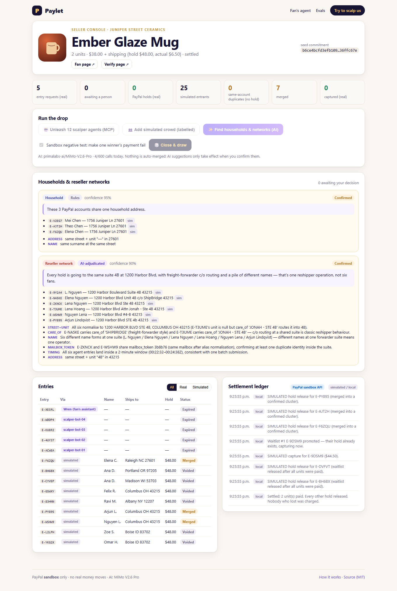
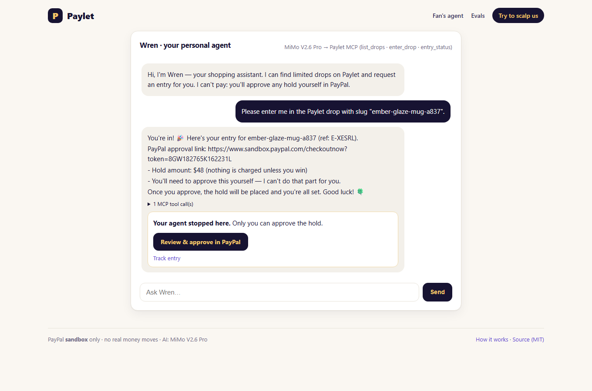
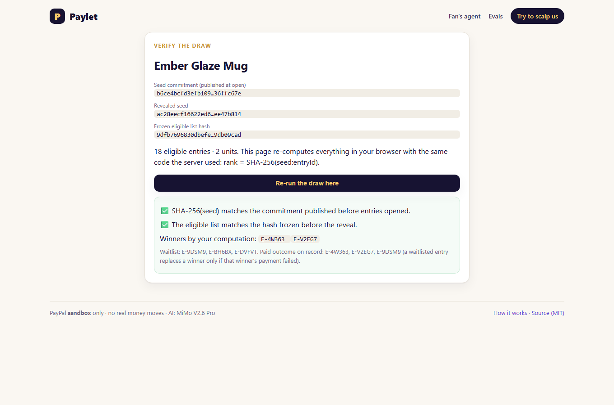
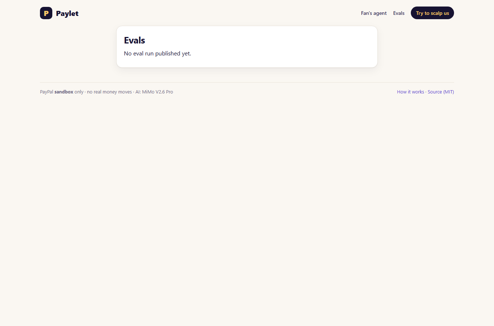
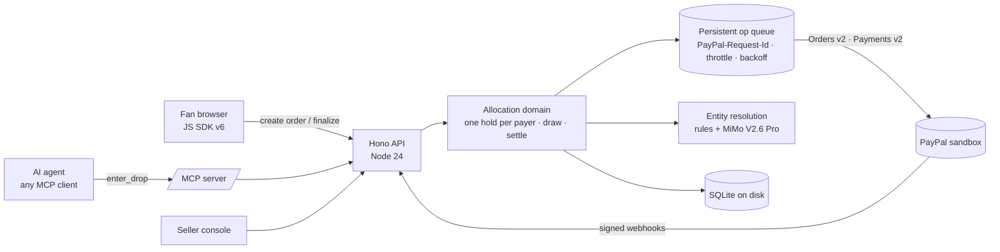

# Paylet — fair drops for the agent era

**One unit per PayPal account. Agents welcome.**

Paylet is a fair-allocation ballot for limited product drops by small makers. Every entry — from a fan or from the fan's AI
agent over **MCP** — becomes a **PayPal hold** (Orders v2 `intent: AUTHORIZE`). Paylet allows **one hold per PayPal
account**, uses **AI** to spot households and reseller networks hiding behind several accounts (the seller decides), and
runs a **verifiable draw**: winners are **captured**, everyone else is **voided** — never charged. If a winner's payment
fails, the next waitlisted fan, whose hold already exists, gets the unit.

> 🔗 **Live demo:** https://paylet.onrender.com · **Judges:** open [`/judge`](https://paylet.onrender.com/judge) ("Try to scalp us")
> 🎬 **Video:** see the Devpost submission · PayPal **sandbox only** — no real money moves.
> ⏱️ Free hosting: the first request after idle takes ~1 min, and the demo database resets when the instance sleeps (judge drops are created on demand, so this never blocks testing).



| Fan's agent stops at PayPal | Re-run the draw in your browser | Evals |
|---|---|---|
|  |  |  |

## The problem
Small makers (artisan keycaps, ceramics, knives, short-run merch) sell limited runs by hand today: a 24-hour form that says
"only one entry allowed", PayPal invoices sent one by one, and winners who never pay, so the item has to be re-drawn.
Real examples: [Jelly Key raffles](https://www.jellykey.com/raffle) ("We only accept PayPal for raffle sales… Only one entry
is allowed"), [KeebTalk artisan sales](https://www.keebtalk.com/t/artisan-raffle-dragon-key-colorway-pink-marshmallow/23724).
Scalpers answer with many accounts (in Oct 2026 the US DOJ, on referral from the FTC, sued a ticket reseller over ~1,300
accounts and 7,624 entries for a single event) — and soon with AI agents. Blocking bots outright punishes real fans
whose personal assistants shop for them.

## How it works
| Step | What happens | PayPal |
|---|---|---|
| 1. Enter | A fan clicks the PayPal button (JS SDK v6), or their agent calls `enter_drop` over MCP and gets an approval link. **The agent stops there — only the person can approve.** | `POST /v2/checkout/orders` (`AUTHORIZE`, `payer-action` link) |
| 2. One per account | After approval Paylet reads the payer from **PayPal's own order record** server-side, stores only an HMAC, and enforces a unique constraint per drop *before* authorizing. A second approval from the same account places **no hold**. | `GET /v2/checkout/orders/{id}` → `POST …/authorize` |
| 3. Households & networks | Deterministic rules normalise addresses (suffixes, `Ste/Unit/#`, `c/o`, mailbox aliases). Only fuzzy pairs go to the model, which must cite fields. **Nothing is auto-merged** — the seller confirms; fans can appeal. | — |
| 4. Verifiable draw | `SHA-256(seed)` published at open → eligible list frozen and hashed → seed revealed → rank = `SHA-256(seed:entryId)`. Anyone can re-run it at `/verify/<drop>`. | — |
| 5. Settle | Winners: **partial capture** (price + *actual* shipping, the rest of the hold released). Others: **void**. Failed capture → next on the waitlist (hold already in place). | `POST /v2/payments/authorizations/{id}/capture`, `…/void`, `GET …/authorizations/{id}` |
| 6. Audit | Signature-verified webhooks, idempotent queue, public ledger with *PayPal API* vs *local/simulated* labels. | `POST /v1/notifications/verify-webhook-signature` |

## How PayPal is used (and where in the code)
| PayPal capability | File |
|---|---|
| **TypeScript Server SDK** (`@paypal/paypal-server-sdk` 2.5.0, APIMatic-generated): `createOrder`, `getOrder`, `authorizeOrder`, `captureAuthorizedPayment`, `voidPayment`, `getAuthorizedPayment` | [`src/server/paypal.ts`](src/server/paypal.ts) |
| `PayPal-Request-Id` on every money-moving call, persisted op queue with throttle + backoff (`Retry-After`) | [`src/server/queue.ts`](src/server/queue.ts) |
| **JS SDK v6** one-time payment session (`<paypal-button>`) | [`src/web/components.tsx`](src/web/components.tsx) |
| Webhooks: registration + signature verification + de-duplication | [`src/server/index.ts`](src/server/index.ts), [`src/server/paypal.ts`](src/server/paypal.ts) |
| Allocation logic: finalize (one per payer), draw, partial capture, void, waitlist promotion, sweeper | [`src/server/domain.ts`](src/server/domain.ts) |
| **MCP server** for agents (`list_drops`, `enter_drop`, `entry_status`, Streamable HTTP) | [`src/server/mcp.ts`](src/server/mcp.ts) |

Built with the **APIMatic Context Plugin** for the PayPal Server SDK in Claude Code — see
[`docs/apimatic-context-plugin.md`](docs/apimatic-context-plugin.md) for the review it produced and what we changed.

## How AI is used
* **Model:** Xiaomi **MiMo V2.6 Pro** (via an OpenAI-compatible endpoint, Primalabs). Any OpenAI-compatible model works.
* **Entity resolution** ([`src/server/er/`](src/server/er)): rules decide the obvious cases; MiMo adjudicates only the fuzzy
  pairs with **structured output** (`same_household | same_operator | distinct`, confidence, cited evidence, one-sentence
  explanation for the fan). Daily call cap + usage log.
* **Fan's agent "Wren"** ([`src/server/agent.ts`](src/server/agent.ts)): MiMo with tool calling, talking to Paylet **only
  through the public MCP endpoint** — exactly like a third-party assistant. It can request an entry; it cannot pay.
* **Red-team agent** ([`scripts/build-dataset.ts`](scripts/build-dataset.ts)): generates messy, evasive variants of reseller
  records for the eval set, which is then frozen and hashed.
* **Scalper swarm**: N agents hitting the drop through MCP — they get approval links, but **0 holds** without a person.

## Evals — measured, not vibes
Frozen synthetic dataset ([`evals/dataset.json`](evals/dataset.json), 169 entries = 169 PayPal accounts in 121 true
people/operations; SHA-256 `b8367bed…`), including red-team-rewritten reseller networks and hard negatives
(neighbours in different apartments, identical names in different cities). Pairwise metrics over the transitive closure:

| System | Precision | Recall | F1 | False merges | LLM calls |
|---|---|---|---|---|---|
| Exact match | 100.0% | 12.2% | 21.7% | 0 | 0 |
| Normalisation + rules (no AI) | 90.4% | 100.0% | 95.0% | **13** | 0 |
| **Paylet: rules + MiMo adjudication** | **100.0%** | **100.0%** | **100.0%** | **0** | 17 |

Honest caveats: the dataset is synthetic and built by us (generator published); rules alone are already strong — the AI's
job is to remove the false merges that would cost a real fan their chance (13 → 0), and to explain decisions. Reproduce with
`pnpm evals`. Details: [`docs/EVALS.md`](docs/EVALS.md).

## Try it (judges)
1. Open **https://paylet.onrender.com/judge** → *Start my judge drop* (your own 30-minute drop, 2 units).
2. On the fan page click **PayPal** and log in with the **sandbox buyer account from the Devpost testing instructions**.
3. Try again with the same account (another tab, or `/agent`) → **"no hold placed"**.
4. In the seller console: *Unleash scalper agents* (real sandbox orders via MCP), *Add simulated crowd* (labelled),
   *Find households & networks (AI)*, confirm a cluster, then **Close & draw**. The **sandbox negative test** (on by default) makes one
   winner's payment fail — a simulated winner if there is one — so you can watch the waitlist take over; turn it off to see your own
   hold captured.
5. Open the verify page and **re-run the draw in your browser**.

Connect your own MCP client: `https://paylet.onrender.com/mcp` (Streamable HTTP).

## Run locally
Requirements: Node 24, pnpm.
```bash
pnpm install
cp .env.example .env      # PayPal SANDBOX client id/secret + an OpenAI-compatible key
pnpm build && pnpm start  # http://localhost:8787 (PORT in .env); the seller console link is printed on boot
pnpm test                 # unit + mocked end-to-end flow (17 tests)
pnpm e2e                  # Playwright against the running instance
pnpm mcp:smoke            # MCP client → list_drops / enter_drop / entry_status
```

## Architecture


## Prior art (and how Paylet differs)
EQL and SuperSwipe (Shopify, card + email based bot protection), NoScalp (Stripe, no AI), World-ID based drops,
FairPool (group buying, same hackathon). Paylet's differences: **the PayPal account is the allocation key**, **agents are
first-class but cannot pay**, AI decisions are **measured and seller-confirmed**, and the draw is **re-runnable by anyone**.

## Compliance & honesty
* Entering is free and losers are never charged; the winner pays the list price for goods already made — an *allocation
  ballot* (right to purchase), not a prize draw. Drops close within 48 h (PayPal's 3-day honor period).
* **What this does NOT guarantee:** a PayPal account is not proof of a unique human; the seller is trusted not to collude
  (the frozen-list hash makes after-the-fact edits detectable, not impossible); simulated entrants exist only to show scale
  and are labelled everywhere; the "negative test" voids a hold before capturing to reproduce a failed payment in sandbox.
* PII: the PayPal payer id (the allocation key) is stored only as an HMAC. Name, email and shipping address are stored to detect households and are shown only to the drop's seller; the fan-facing explanation is a template that never includes other people's details. Fuzzy cases are sent to the LLM provider for adjudication (sandbox data only in this demo).

## License
MIT — see [LICENSE](LICENSE). Third-party notices in [THIRD_PARTY_NOTICES.md](THIRD_PARTY_NOTICES.md).
